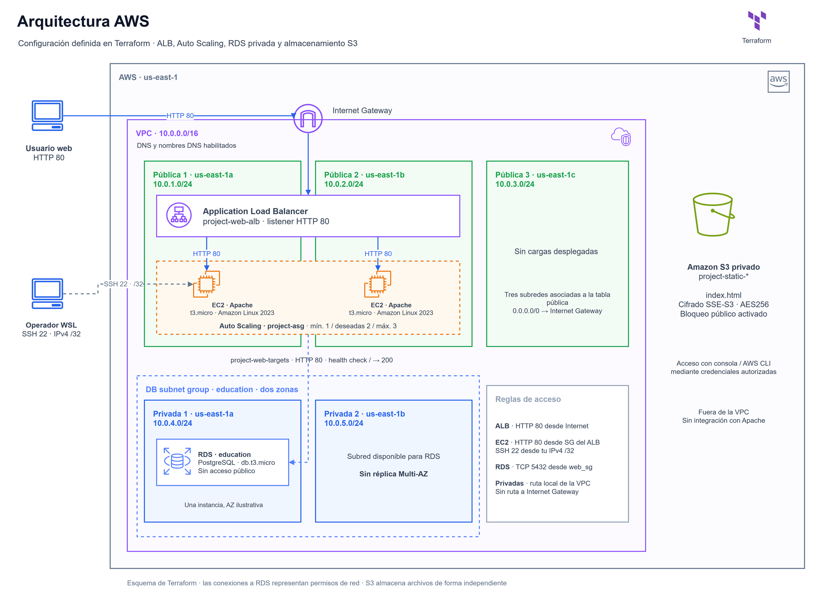
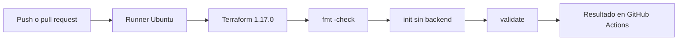

# Despliegue automatizado de infraestructura en AWS

Laboratorio con Terraform: un ALB reparte peticiones HTTP entre EC2 con Amazon Linux 2023 y Apache, gestionadas por un Auto Scaling Group, con RDS PostgreSQL privada.

Versión personal de una práctica de instituto. Incluye integración continua de Terraform con GitHub Actions. El despliegue con Jenkins se incorporará en una siguiente fase.

## Arquitectura



[Editar en draw.io](<Arquitetura AWS.drawio>)

Tres subredes públicas y dos privadas. El ALB y el ASG utilizan dos zonas, con **2 EC2** deseadas (mínimo 1, máximo 3). Recorrido: **Internet → ALB:80 → EC2:80**. Las EC2 solo aceptan HTTP desde el ALB y SSH desde tu IPv4 `/32`; RDS acepta PostgreSQL desde las EC2.

El diagrama refleja la configuración de Terraform: RDS privada en un grupo de dos subredes y S3 privado fuera de la VPC. [Versión con iconos AWS 2017](<Arquitetura AWS 2017.drawio>).

## Integración continua con GitHub Actions

El workflow [Terraform CI](.github/workflows/terraform-ci.yml) comprueba el proyecto en cada push a `git_actions` o `main`, y en pull requests dirigidas a esas ramas. Se ejecuta también para cambios de documentación, de modo que el check no queda pendiente por filtros de rutas.



| Paso | Qué comprueba |
| --- | --- |
| `terraform fmt -check -recursive` | Formato del código Terraform; falla si necesita cambios. |
| `terraform init -backend=false -input=false -lockfile=readonly` | Instala el proveedor fijado en `.terraform.lock.hcl`, sin inicializar un backend ni modificar el lockfile. |
| `terraform validate` | Coherencia de la configuración y argumentos según el esquema del proveedor. |

El runner usa permisos `contents: read`, no conserva las credenciales del checkout y cancela ejecuciones anteriores del mismo workflow y referencia. Las acciones están fijadas por SHA; [Dependabot](.github/dependabot.yml) propone sus actualizaciones semanalmente. La versión de Terraform se actualiza manualmente en el workflow.

Esta CI no necesita secrets de AWS, contraseña de RDS ni clave SSH. Descarga Terraform y el proveedor por Internet, pero no ejecuta `plan`, `apply` o `destroy`. Un check correcto no demuestra que las cuotas, los permisos, las credenciales o los valores elegidos permitan desplegar en AWS.

### Probar la rama

Una vez publicado el workflow en `git_actions`, abre **Actions → Terraform CI** para consultar el resultado del push. Las pull requests hacia `main` ejecutan el mismo check. La ejecución manual con **Run workflow** estará disponible cuando el workflow exista en la rama predeterminada.

Para reproducir los pasos en WSL, desde la raíz del repositorio:

```bash
terraform fmt -check -recursive
terraform init -backend=false -input=false -lockfile=readonly
terraform validate
```

Si falla el formato, ejecuta `terraform fmt -recursive`, revisa el diff y repite la comprobación. Puedes configurar `Terraform checks` como check obligatorio en las reglas de protección de `main` tras su primera ejecución; esa protección no la crea este archivo.

### Siguiente fase: despliegue con Jenkins

La separación prevista es **GitHub Actions para CI** y **Jenkins para despliegue**. Jenkins todavía no está configurado: no hay `Jenkinsfile` ni conexión automática entre ambos sistemas. El flujo previsto será comprobar el resultado de CI del commit elegido, generar y revisar su plan, aprobar y aplicar ese mismo plan en AWS.

El proyecto todavía utiliza estado local. Antes de desplegar desde un agente Jenkins hay que preparar un backend remoto privado con bloqueo y migrar el estado existente de forma controlada. El bucket de `s3.tf` almacena el HTML de ejemplo; no es un backend de Terraform. No deben desplegar WSL y Jenkins con estados independientes sobre los mismos recursos.

También será necesario configurar las credenciales AWS en Jenkins, las variables de RDS y SSH, la aprobación de despliegues y la exclusión de ejecuciones simultáneas. Las credenciales temporales de Academy caducan; el agente no hereda automáticamente `~/.aws/credentials` ni las claves de tu WSL. El estado y los planes pueden contener datos sensibles y deben conservarse en almacenamiento privado con acceso controlado.

## Paso a paso en WSL

Necesitas Terraform **>= 1.17.0**, AWS CLI y curl. Ejecuta desde la carpeta del proyecto. Región predeterminada: `us-east-1`.

### 1. Credenciales del laboratorio

Si las credenciales faltan o aparece `ExpiredToken`, inicia el laboratorio en AWS Academy y abre **AWS Details → AWS CLI**. En WSL:

```bash
mkdir -p ~/.aws
nano ~/.aws/credentials
```

En el perfil `[default]`, pega los tres valores actuales del laboratorio. Este ejemplo solo muestra el formato; sustituye los placeholders y conserva otros perfiles que ya existan:

```ini
[default]
aws_access_key_id = YOUR_ACCESS_KEY_ID
aws_secret_access_key = YOUR_SECRET_ACCESS_KEY
aws_session_token = YOUR_SESSION_TOKEN
```

Guarda con **Ctrl+O → Enter** y sal con **Ctrl+X**. Después:

```bash
chmod 600 ~/.aws/credentials
aws sts get-caller-identity
```

Si devuelve tu identidad, puedes continuar. Las credenciales caducan: repite este paso cuando ocurra. Si usas otro perfil, actualiza ese perfil en lugar de `[default]`.

**Si sigue apareciendo `ExpiredToken`:** unas credenciales antiguas exportadas pueden tener prioridad sobre el archivo. Para usar las del archivo, ejecuta en esa terminal y comprueba otra vez:

```bash
unset AWS_ACCESS_KEY_ID AWS_SECRET_ACCESS_KEY AWS_SESSION_TOKEN AWS_SECURITY_TOKEN
aws sts get-caller-identity
```

`aws configure` vuelve a pedir clave de acceso y clave secreta, pero **no pide el token de sesión**. Enter sin escribir conserva el valor anterior; por eso en Academy actualizamos las tres entradas del archivo.

### 2. Ver tu IP pública y configurar SSH

Para ver la IP pública de tu conexión, ejecuta en WSL:

```bash
curl -4 https://checkip.amazonaws.com
```

La dirección devuelta es **tu IP pública**, desde la que conectarás. Sustituye `TU_IP_PUBLICA` abajo por ese número. `/32` permite solo esa IP. Ejecuta estas líneas en la misma terminal que Terraform; repítelas si abres otra:

```bash
export TF_VAR_ssh_allowed_cidr="TU_IP_PUBLICA/32"
export TF_VAR_ssh_public_key_path="$HOME/.ssh/project-asg.pub"
```

Comprueba si existe la clave pública:

```bash
ls ~/.ssh/project-asg.pub
```

Si no existe y tampoco tienes la privada `~/.ssh/project-asg`, créala una sola vez:

```bash
mkdir -p ~/.ssh
ssh-keygen -t ed25519 -f ~/.ssh/project-asg
```

No sobrescribas una clave existente. Terraform necesita la pública `.pub`; SSH utiliza la privada sin `.pub`.

### 3. Desplegar y consultar los servidores

```bash
terraform init
terraform validate
read -rsp 'Contraseña para RDS: ' TF_VAR_db_password
echo
export TF_VAR_db_password
terraform plan
terraform apply
terraform output -raw alb_url
terraform output -json instance_public_ips
```

Revisa el plan y escribe `yes` solo cuando pida confirmar. Si pregunta por `ssh_allowed_cidr`, espera una IP con `/32`, no `yes`.

Abre la URL de `alb_url` en el navegador: el listener HTTP del ALB envia las peticiones al grupo de destinos del ASG. La página muestra el hostname de la EC2 que responde; al hacer varias peticiones puede cambiar.

`instance_public_ips` muestra **las IP de las EC2**, no la de tu ordenador. Úsalas para SSH: `ssh -i ~/.ssh/project-asg ec2-user@IP_PUBLICA_EC2`. El HTTP directo a esas IP está cerrado; entra por el ALB. Las IP son una instantánea y pueden cambiar. Si el output no existe, no ejecutes `apply` solo para recuperarlo si quieres borrar.

Para comprobar los destinos del ALB después del despliegue:

```bash
aws elbv2 describe-target-health --region us-east-1 \
  --target-group-arn "$(terraform output -raw web_target_group_arn)" \
  --query 'TargetHealthDescriptions[].{Instance:Target.Id,State:TargetHealth.State,Reason:TargetHealth.Reason}'
```

Espera a `healthy`: Apache debe responder `200` en `/`. Al arrancar, la instalación y las comprobaciones tardan unos minutos. Un `503` puede indicar que aún no hay destinos disponibles; revisa el comando anterior. El ASG usa estas comprobaciones y da 300 segundos de gracia al arrancar.

### Almacenamiento estático en S3

`s3.tf` crea un bucket privado, con bloqueo público, ACL desactivadas y cifrado SSE-S3 (`AES256`). Terraform sube `static/index.html`; al modificarlo y ejecutar `apply`, actualiza el objeto. El bucket hereda las etiquetas del proveedor y su nombre lleva un sufijo único.

Después de desplegar, consulta el bucket y lee el archivo con tus credenciales:

```bash
terraform output -raw static_bucket_name
aws s3 ls "s3://$(terraform output -raw static_bucket_name)/"
aws s3 cp "$(terraform output -raw static_object_uri)" -
```

Es almacenamiento privado, sin endpoint web público. No está dentro de una subred y este ejemplo no conecta Apache con S3. Para documentarlo, captura **S3 → bucket → Objetos** y **Permisos → Bloquear acceso público**.

### 4. Borrar al terminar

Con credenciales vigentes y las variables del paso 2 cargadas:

```bash
terraform destroy
terraform state list
```

Revisa los recursos y confirma con `yes`. Espera a `Destroy complete!`; `Still destroying...` es normal y puede durar minutos. No pulses `Ctrl+C`: interrumpe el proceso. Después, `state list` debe quedar vacío. Tras borrar, los outputs desaparecen.

Terraform elimina su `index.html` de S3 antes de borrar el bucket. Si añadiste otros archivos manualmente, `force_destroy = false` impide borrar un bucket con contenido: conserva lo necesario y retira solo esos archivos antes de repetir el borrado.

### Errores que nos han salido

| Mensaje o situación | Qué hacer |
| --- | --- |
| `ExpiredToken` o credenciales borradas | Repite el paso 1 y comprueba la identidad antes de usar Terraform. |
| `Invalid value for variable` tras escribir `yes` | Repite el paso 2. `ssh_allowed_cidr` pide tu IP con `/32`; `yes` solo confirma el plan. |
| Un comando usa `${mi_ip}` | Esa variable debe definirse antes en la misma terminal. Los comandos anteriores usan `TF_VAR_ssh_allowed_cidr` y no necesitan `mi_ip`. |
| `operation canceled` tras `Ctrl+C` | La operación se interrumpió. Espera a que termine el proceso y vuelve a ejecutar `terraform destroy` para borrar lo pendiente. |
| `Output "instance_public_ips" not found` | El output no está guardado. Mira `terraform state list`: el error por sí solo no demuestra que no haya recursos. No recrees infraestructura para obtener IP si vas a borrar. |
| Terraform tarda sin mostrar nada | El arranque y las consultas a AWS pueden tardar varias decenas de segundos. No lo canceles solo por esa espera. |

Si vuelve a pedir la IP porque abriste otra terminal, repite el paso 2. También puedes pasarla directamente, sustituyendo `TU_IP_PUBLICA`:

```bash
terraform destroy -var="ssh_allowed_cidr=TU_IP_PUBLICA/32"
```

Conserva `terraform.tfstate`: permite a Terraform identificar lo que debe borrar. No elimines el estado ni fuerces desbloqueos para resolver una interrupción.

El ALB, las EC2, sus discos y las IPv4 públicas pueden consumir créditos. Quitar el Internet Gateway no elimina el cargo de una IPv4 asignada. Si una SCP bloquea `autoscaling:StartInstanceRefresh`, debe revisarlo el administrador del laboratorio.

Mantén credenciales, claves privadas y estado de Terraform fuera del repositorio.
